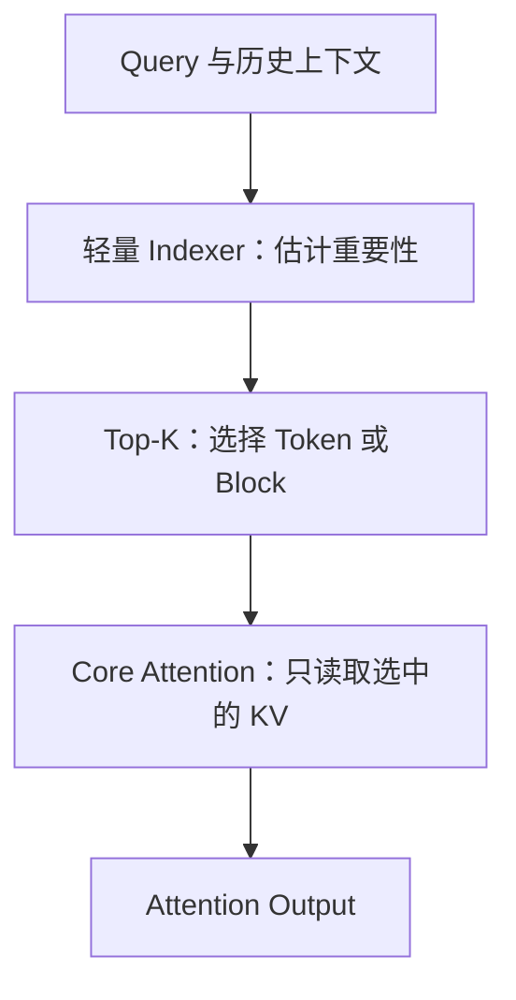
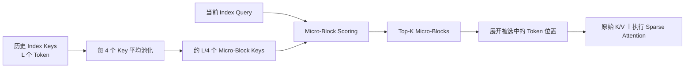
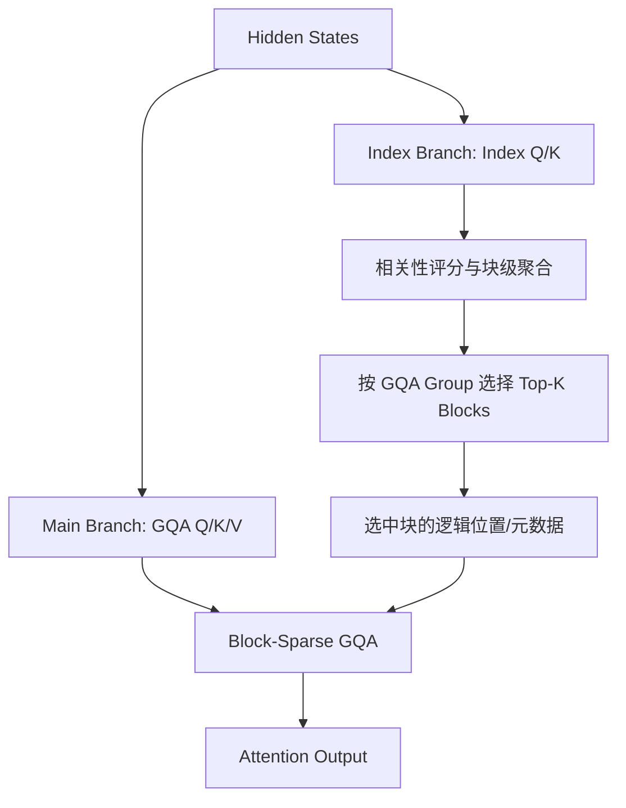
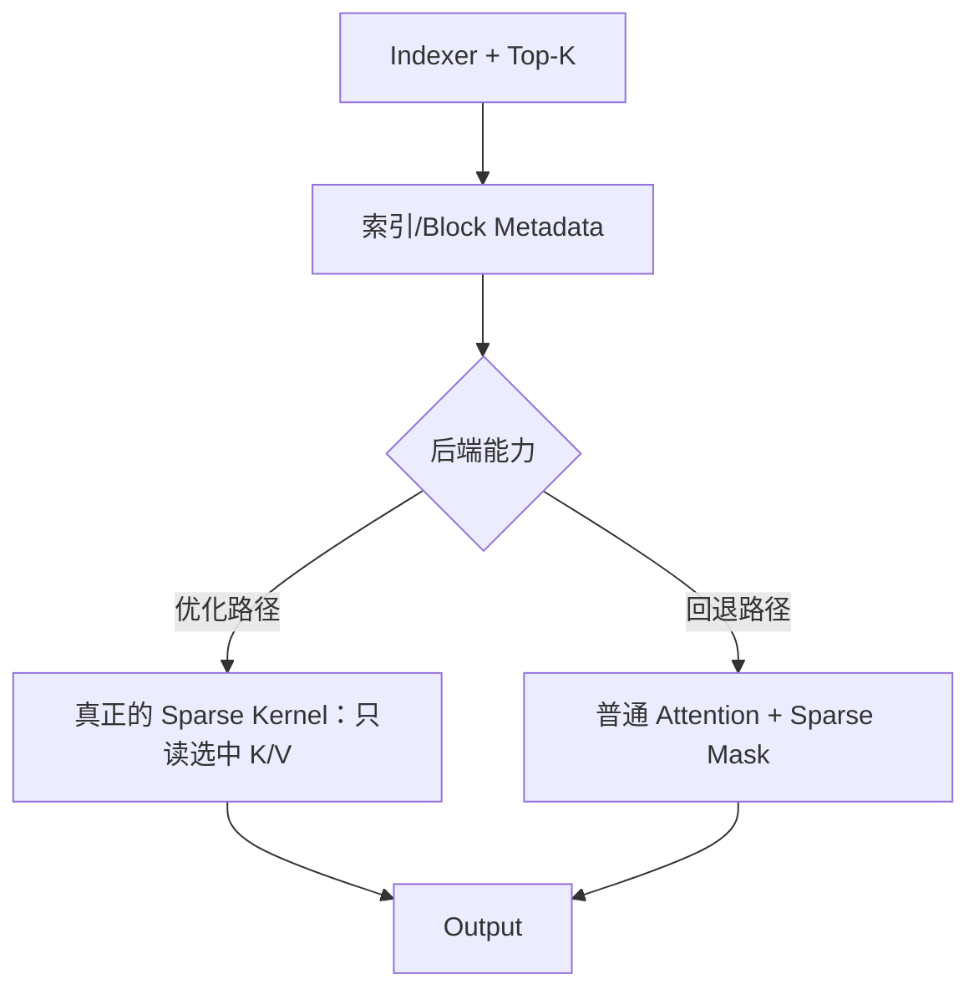

> **摘要**：长上下文场景中，Dense Attention 每个 Decode Token 都需要访问随历史长度增长的 KV Cache。DSA、QSA、MSA 均通过“轻量 Indexer → Top-K 选择 → 稀疏核心 Attention”的框架降低主 Attention 成本，但三者在选择粒度、索引数据组织、块级归约、注意力后端上存在实质差别。本文从原理到算子实践进行对比，并讨论在 vLLM-Ascend 上适配时需要关注的问题。
>
> **阅读前提**：了解 GQA/MLA、Prefill/Decode、KV Cache、Causal Mask。文中的示例图和理论计算用于解释机制，不代表实测性能。文中使用的 MSA 配置应以目标 checkpoint 的 `config.json` 与对应代码版本为准。

## 1. 为什么需要稀疏 Attention？

给定单个查询 $q_t$ 和长度为 $L$ 的历史键值对，标准 Attention 为

$$
 o_t = \operatorname{softmax}\!\left(\frac{q_tK_{\le t}^{\top}}{\sqrt d}+M_t\right)V_{\le t}.
$$

这里 $M_t$ 是因果遮罩。单个 Decode Token 的 Attention 读/算开销通常随历史长度 $L$ 线性增长；整段长度为 $L$ 的 Dense Prefill 自注意力则具有 $O(L^2)$ 的序列维度计算量。

稀疏方法改为：



因此一定要拆开分析：

$$T_{\mathrm{sparse}}=T_{\mathrm{indexer}}+T_{\mathrm{select}}+T_{\mathrm{core}}+T_{\mathrm{misc}}.$$

如果只给主 Attention 加稀疏 Mask，却仍让 Dense Kernel 计算所有位置，则数学上的稀疏未必能变为真实的访存/计算节约。

## 2. 一张表概括三个方案

| 维度 | DSA（DeepSeek） | QSA（Qwen） | MSA（MiniMax） |
|---|---|---|---|
| 代表模型 | DeepSeek-V3.2 | Qwen3.8-Flash-Next | MiniMax-M3 |
| 选择粒度 | 单个 Token | Micro-Block | 较大的 KV Block |
| 典型粒度 | 1 Token | 4 Token/微块 | 128 Token/块（示例/典型配置） |
| Indexer | Lightning Indexer | Compressed Lightweight Indexer | Lightweight Index Branch |
| 索引打分 | 逐 Token | 压缩索引 Key 后逐微块 | 逐 Token 评分后形成 Block Score |
| Select 输出 | Token IDs | 微块 IDs | Block IDs，按 GQA group 独立选择 |
| Core Attention | 稀疏 MLA | 微块稀疏 GQA | Block-Sparse GQA |
| 优先优化点 | 细粒度召回 | 减少索引候选数 | 块级执行效率 |

> **重要提示**：128 和 Top-K=16 是 MiniMax-M3 相关配置中常见的分析示例，不能当作所有 MSA 变体的固定定义；论文、模型配置与实现版本应分别核对。尤其不要将 MSA 的稀疏逻辑块大小与 Paged KV Cache 的物理页大小混淆。

## 3. DSA：逐 Token 检索，再做稀疏 MLA

DSA 的核心组件是 **Lightning Indexer** 与 **Fine-grained Token Selection**。Indexer 为当前 Query 与每个历史 Token 计算重要性分数。论文给出的形式可写为：

$$
I_{t,s}=\sum_{j=1}^{H_I}w^I_{t,j}\operatorname{ReLU}\left(\left\langle q^I_{t,j},k^I_s\right\rangle\right).
$$

其中 $s$ 是历史 Token 位置，$j$ 是 Indexer Head，$w$ 是与当前 Query 有关的权重。得到分数后：

$$\mathcal S_t=\operatorname{TopK}_s(I_{t,s},K),\qquad o_t=\operatorname{MLA}(q_t,K_{\mathcal S_t},V_{\mathcal S_t}).$$

DeepSeek-V3.2 的典型 `index_topk=2048`。Indexer 选择的 Token 可以来自非常分散的历史位置。

**示意：** 在 16 个历史 Token 中，最终选出 2、5、10、14 号位置（仅教学示例，不是模型输出）：

```text
历史 Token:  01 02 03 04 05 06 07 08 09 10 11 12 13 14 15 16
DSA 保留:    ·  ●  ·  ·  ●  ·  ·  ·  ·  ●  ·  ·  ·  ●  ·  ·
```

**优点**：选择精细，不必因为某个 Token 重要而附带加载一整块的无关 Token。**代价**：每个 Query 的轻量 Indexer 仍需考虑可见历史中的大量 Token。注意，Index Key 远小于完整 KV，不能把“扫描全长索引”误解为“读取全长完整 KV”。

## 4. QSA：通过 Micro-Block 压缩降低 Indexer 成本

QSA 保留两阶段架构，但在 Indexer 端改变评分单位：**每 $r$ 个 Token 构成一个 Micro-Block，先聚合 Index Key，再以微块为单位做 Top-K。** Qwen3.8-Flash-Next 使用的典型压缩比为 $r=4$。

令 $p_b=br$ 为第 $b$ 个微块起点，则压缩键可以抽象为：

$$\bar k_b=\operatorname{RMSNorm}\left(\frac 1r\sum_{j=0}^{r-1}k_{p_b+j}\right).$$

实际模型还涉及独立线性投影和 Partial RoPE 的具体顺序。Indexer 对各微块打分，选择高分 Block IDs，再展开到原始 Token 位置执行 Sparse Core Attention：



**注意：压缩的是索引表示，不是把主 Attention 的四个 K/V Token 永久压成一个。** KV Cache 如何组织仍需看核心 Attention 与混合层架构。

如果 $L=131072$，$r=4$，需要打分的微块数约为

$$131072/4=32768.$$

相比逐 Token Indexer，候选评分位置缩减为原来的四分之一；这不是端到端速度必然提升四倍，因为 Top-K、Gather、Core Attention、Kernel Launch 仍占成本。QSA 对最后一个不完整微块和 Causal 可见性也有额外处理，不能简单用 `reshape(-1, 4)` 就覆盖所有序列情况。

**示意：**

```text
历史 Token:   00 01 02 03 | 04 05 06 07 | 08 09 10 11 | 12 13 14 15
微块编号:          B0    |      B1     |      B2     |      B3
选中微块:           ·     |      ●      |      ·      |      ●
主 Attention:  ·  ·  ·  · |  ●  ●  ●  ● |  ·  ·  ·  · |  ●  ●  ●  ●
```

**本质**：DSA 把“候选重要性”放在 Token 层面，QSA 在更廉价的压缩候选空间中先做粗检索，随后返回细粒度原始 Token 计算。

## 5. MSA：Index Branch + 按 GQA Group 的 Block-Sparse Attention

MiniMax Sparse Attention（MSA）在 GQA 上设计块级检索，核心是：**Index Branch 对历史 KV Block 估计重要性；每个 GQA Group 独立选择 Top-K Blocks；Main Branch 仅在选中的块上执行精确 Attention。**



为了直观理解，可将其 Block Score 简化为：先估计 Token 级别的索引相关性，再在块内聚合（例如 Block Max）。

$$s_{t,j,g}=\operatorname{IndexScore}(q^I_{t,g},k^I_j),\qquad S_{t,b,g}=\max_{j\in B_b}s_{t,j,g}.$$

> 上式是解释 **Token 评分 → Block 评分** 的抽象表达，具体打分/归约与 Kernel 路径应以对应版本的 MSA 论文和源代码为准；不能把所有实现直接等同于这个简化公式。

**为什么块级 Max 具有意义？** 某个 128-Token Block 中即使只有一个关键 Token，也可以因为其较高分数进入候选集合。而 QSA 的 Index Key 平均池化是在索引打分前对 Key 表示作压缩，两者的操作次序和含义不同。

MSA 的选择以整块为单位。如果最终保留 16 个完整的 128-Token 块，其最大逻辑 Token 容量为

$$16\times128=2048.$$

但实际有效 Token 数还受尾块、重复块、因果可见性和保留局部块规则影响。Local Block、Init Block 是否计入预算、Top-K 如何去重、不同 GQA group 是否独立选择，都必须依具体配置确认，不能无条件认定为“16 个动态块之外再加一个 Local Block”。

**示意：**

```text
历史 KV Blocks: B0 B1 B2 B3 B4 B5 B6 B7 B8 B9 B10 B11
Indexer 选择:   ·  ●  ·  ●  ·  ·  ●  ·  ·  ●  ·   ·
Local 强制保留: ·  ·  ·  ·  ·  ·  ·  ·  ·  ·  ·   ●
Main GQA 读取:  仅选择的 KV Blocks（并执行 Causal/Valid Mask）
```

**工程优势**：一次选中的块包含多个连续 K/V 位置，更适合硬件 Tile 计算及 KV 数据复用。**工程代价**：块内可能存在大量低重要性 Token，此外轻量索引扫描与稀疏选择仍然有自身开销。

## 6. 三者放在同一个 128K Decode 场景中

统一令 $L=131072$，目标 Core Attention 稀疏预算约为 2048 Token，忽略少量尾块处理：

| 对比项 | DSA | QSA | MSA |
|---|---:|---:|---:|
| Indexer 历史候选数（示例） | 131072 Token | 32768 Micro-Blocks | 131072 Token 级索引评分，归约成 Block |
| Top-K 单位 | Token | 4-Token Micro-Block | 128-Token KV Block |
| 对应 2048 Token 预算 | 2048 Tokens | 512 完整微块 | 16 完整大块 |
| Core Attention 连续访问粒度 | 最小 | 微块 | 大块 |
| 典型挑战 | 离散 Gather | 压缩评分与微块索引 | Block 选择与块内无效计算 |

这不是跨模型速度排名。DSA、QSA、MSA 的主 Attention（MLA/GQA）、参数规模、Indexer 维度、缓存布局、硬件后端不同。没有相同模型、硬件、序列长度、Batch Size 下的可比 Benchmark，不应推导“QSA 比 MSA 快”或相反。

从复杂度角度看：

- **Decode 单步**：Indexer 对历史的扫描成本常随 $L$ 增长（DSA/MSA 候选是 Token，QSA 候选约 $L/r$）；主 Core Attention 在预算固定时主要随稀疏预算 $K$ 增长。
- **Prefill 全序列**：所有 Query 对历史进行索引，未经进一步算法优化时，逐 Token 打分有二次序列规模；QSA 将 Key 候选按 $r$ 压缩，降低有效评分量。实际吞吐还依赖 Kernel Tile、缓存命中和并行策略。

## 7. 从 vLLM-Ascend 看，难点不止在 Top-K

### 7.1 稀疏 Mask 与真正的 Sparse Kernel

如果实现路径是先计算完整 $QK^T$，再把无关位置加上 $-\infty$ Mask，那么 Attention **结果** 稀疏，但 Kernel 仍可能进行大量 Dense 计算。真正的加速应在主路径中尽可能跳过未选中 KV Block 的读取和矩阵计算。

可以区分两条执行路径：



回退路径有助于保障功能和精度，但不应自动视为性能等价。

### 7.2 Causal Mask、Local Block、尾块

假设一个块为 128 Tokens，真实序列只有 300 Tokens：

```text
B0: 0..127       全部有效
B1: 128..255     全部有效
B2: 256..383     只有 256..299 是有效的序列 Token
```

如果 Query 位于 Token 280，即使稀疏索引选中 B2，也只能看到 `256..280`。`281..299` 是未来位置，`300..383` 是填充位置。逻辑上选中 Block 不代表 Block 内所有 Token 都可见。

需验证：

1. 同一块内对不同 Query 的可见范围是否正确；
2. Top-K 是否可能重复命中 Local Block、去重后预算怎么处理；
3. 逻辑 Block ID 是否正确映射到物理 KV Cache；
4. Prefill、Chunked Prefill、Decode 的 Mask 语义是否一致；
5. 图模式 Capture/Replay 时 Buffer 形状和地址是否稳定。

### 7.3 图模式与动态 Top-K

Top-K 值本身随输入变化，但 Graph Replay 更关注 Tensor Shape、内存地址和控制流的稳定性。常见思路是固定容量的索引结果 Buffer，使用有效长度/有效性标记描述不同请求，并让算子按固定或可兼容的 Shape 执行。具体能否捕获取决于当前 NPU Kernel、vLLM-Ascend 版本和调用路径。

### 7.4 建议的 Profiling 拆解

对同一模型，在 10K、128K、256K（若支持可扩展至 1M）上下文下，分别分析：

| 组件 | 观察项 | 可能瓶颈 |
|---|---|---|
| Indexer Projection | 投影耗时、中间张量规模 | 矩阵计算 / HBM |
| Indexer Scoring | 长度增长曲线、访存量 | 索引缓存扫描 |
| Block 聚合 / Top-K | Reduce、Select、排序与拷贝 | Kernel Launch / 归约 |
| KV Block Mapping | 物理页跳转、数据组织 | 不连续访存 |
| Sparse Core Attention | 有效 Token 数、Kernel 时间 | Tile 利用率 / HBM |
| 图模式 | Capture 覆盖率、Fallback 比例 | 动态 Shape |

注意性能测试时控制 Batch、并发、输入长度、命中率、精度与硬件一致。不能拿不同架构、不同主 Attention 和不同缓存形态的性能数字直接比较。

## 8. 推荐的源码学习路线

1. **DSA**：从 `Indexer Q/K → Score → Top-K Token IDs → Sparse MLA` 看清细粒度选择的完整调用链。
2. **QSA**：重点理解索引 Key 的投影、Average Pooling、Partial RoPE、压缩块 Top-K 与 Token 展开。
3. **MSA**：重点跟进 Index Branch 的 Tensor Shape、GQA group 维度、Block Scoring、Top-K、Local/Init、`build_block_mask` 与主 Attention Fallback。
4. **Kernel 对比**：区分 Mask 稀疏和实际计算稀疏；分析 Gather、连续块加载、Tile 粒度、Causal 与有效位处理。
5. **部署实证**：通过 Profile 分离 Indexer、Selection、Core Attention，量化长上下文增长曲线，而不是只看端到端 TPS。

## 9. 总结

三个方法的共同目标是：**先判断哪些历史信息重要，再让昂贵的核心 Attention 只处理这些位置**。差异可以用三句话记住：

- **DSA：选重要 Token。** 精确但候选扫描粒度细，选中 KV 的地址可能分散。
- **QSA：先压缩索引，再选 Micro-Block。** 直接降低 Indexer 的候选规模，最终仍在原始 Token 的 K/V 上计算。
- **MSA：先确定重要 KV Block，再做 Block-Sparse GQA。** 为硬件友好的块级访存和 Tile 执行而设计，需认真处理 Block Score、Group、Mask 与物理 Cache 映射。

对推理框架而言，**稀疏算法的收益只有在合适的 KV Cache 数据布局、正确的 Sparse Mask 语义和真正跳过无关读取/计算的 Kernel 中才能完整实现**。

## 参考资料

1. DeepSeek-AI, *DeepSeek-V3.2-Exp: Boosting Long-Context Efficiency with DeepSeek Sparse Attention*：https://paper.arxivhub.com/DeepSeek_V3_2.pdf
2. vLLM, *DeepSeek-V3.2-Exp in vLLM: Fine-Grained Sparse Attention in Action*：https://vllm.ai/blog/2025-09-29-deepseek-v3-2
3. Hugging Face Transformers, *DeepSeek-V3.2 model documentation*：https://huggingface.co/docs/transformers/model_doc/deepseek_v32
4. Qwen Team, *On the Design of Qwen3.8-Next Architecture*：https://arxiv.org/abs/2608.30320
5. Qwen Team, *Qwen3.8-Flash-Next architecture overview*：https://www.alibabacloud.com/blog/qwen-3-8-flash-next-a-new-architecture-towards-ultimate-cost-efficiency_603501
6. MiniMax Team, *MiniMax Sparse Attention*：https://arxiv.org/abs/2606.13392
7. MiniMax MSA implementation：https://github.com/MiniMax-AI/MSA

---

*本文是面向工程实现的学习笔记。未标注的示意数值用于阐释机制，实际模型参数与算子行为请以论文、模型配置及对应版本代码为准。*
